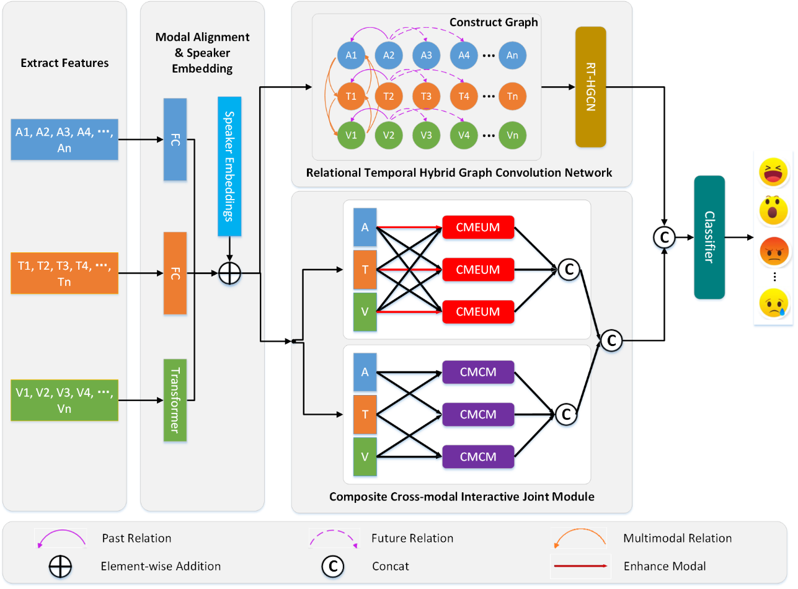

# GRACE
Paper: [GRACE: A Joint Graph and Cross-Modal Fusion Model for Multimodal Conversation Emotion Recognition](https://)

Abstract:

Emotion Recognition in Conversation (ERC) is a crucial task in human-computer interaction, aiming to identify the emotional categories of each utterance in a conversation. Recently, multimodal emotion recognition in conversation has gained popularity due to the insufficient information of unimodal. However, existing multimodal methods with graphs often neglect the differential impact of relationships when modeling local conversational contexts. In addition, in tri-modal tasks, global cross-modal fusion methods at the conversation level fail to address independent bi-modal dependencies. To tackle these problems, we propose the Relational Graph Attention Combination Enhancement (GRACE) model. We first introduce the Relational Temporal Hybrid Graph Convolution (RT-HGCN), which constructs multiple relationships between modalities and context, using attention networks to highlight the varying impacts of relationship edges. Additionally, we propose the Composite Cross-modal Interactive Joint Module (CCIJM), which enhances unimodal information with multimodal input and captures fine-grained dependencies through bidirectional cross-modal interaction. Furthermore, to address the challenges of class imbalance and distinguishing subtle emotions, we design the SFLoss (Focal Loss with Smoothing) loss function to optimize model training. Extensive experiments conducted on IEMOCAP and CMU-MOSEI datasets have demonstrated the superiority of our GRACE model over cutting-edge methods.

Architecture:

## Requirements
```
python==3.11.3
torch==2.0.1
torch-geometric==2.3.1
sentence-transformers==2.2.2
comet-ml==3.33.4
```
### Installation
- [PyTorch Geometric](https://pytorch-geometric.readthedocs.io/en/latest/notes/installation.html)
- [Comet.ml](https://www.comet.ml/docs/python-sdk/advanced/)
- [Sentence Transformer](https://www.sbert.net/)
### Preparing datasets
```
bash run_preprocess.sh
```
### Training
```
bash run_train.sh
```
### Evaluate
```
bash run_eval.sh
```
### Citation
```


```
